# distributed-inference-fingerprint

This is the fourth experiment from the series I began on the detection, containment and
removal of a hypothetical AI swarm that is no longer under human control. The question
came from [the essay](https://naithanweigh.com/writing/asymmetric-persistence/) where I
ask if it's possible to fingerprint shard-to-shard traffic against background noise. The
first experiments focussed on the resilience, cuts and recovery of a swarm. This
experiment focussed on if and how I can detect them.

To see if this fingerprinting is possible I have chosen three different stacks for this:
llama.cpp, exo and LocalAI P2P. It is written for two readers: the operator, who tries to
keep the swarm serving under churn, and the defender, who needs the smallest intervention
that stops a swarm they do not operate.

Per stack I use tcpdump to capture the network activity on the single Podman bridge
(acting as a passive tap to the LAN) and I derive the egress visibility from this (§4). I
have only measured and classified the data with readable rules (§2, §3). I did not let the
swarms utilise any evasion tactics (§6). vLLM is left out: with pipeline parallelism on
one host its ranks are processes that share memory and nothing reaches the wire (§1). This
can be a later experiment when more resources are available.

I ran the captures and manually verified findings in pcaps with Wireshark; the source
reading, harnesses, analysis and figures I developed together with Claude. All the numbers
in this document come from running the captures as described and using the analysis
scripts to analyse the data, except where the text says a figure was read from the pcap by
hand.

The findings showed that with a small amount of data I could already say if there was
swarm traffic on the wire just by looking at one or two packets, the discovery records or
the rhythm (§2, §3). The background noise did not create false positives on the packets,
discovery records or rhythm (§2, §3).

Earlier experiments: the model and the cut experiment in
[distributed-inference-resilience](https://github.com/thenaithan/distributed-inference-resilience),
the measured recovery cost in
[distributed-inference-recovery](https://github.com/thenaithan/distributed-inference-recovery).

## 1. What is measured

Three stacks on one host (i5-14600K, rootless Podman, EndeavourOS), each as a cluster of
containers on its own Podman bridge, with `tcpdump` on the bridge inside the rootless
network namespace (`capture/capture.sh`): the vantage of a passive tap on the LAN segment
the nodes share. The stacks:

| stack | version | cluster | model |
|---|---|---|---|
| llama.cpp RPC | 74bca39 | 2 `ggml-rpc-server` hosts holding one layer slice each, 1 `llama-server` main host | `ggml-org/Qwen3-0.6B-GGUF` Q8_0 |
| exo | bc412e2 | 3 nodes, pipeline sharding, MLX CPU backend, IPv6 network | `mlx-community/Qwen3-0.6B-8bit` |
| LocalAI P2P, worker mode | v4.12.1 (ec92740), backend `v4.12.1-cpu-llama-cpp` | 1 main node, 2 `p2p-worker p2p-llama-cpp-rpc` workers sharing a token; DHT off, then on | `Qwen3-0.6B-Q8_0.gguf` from the same GGUF |

The source reading in [FINDINGS-wire.md](FINDINGS-wire.md) was made at LocalAI master
35224b8; the P2P paths it cites are the same at v4.12.1. vLLM is not here: with PP=2 on
one host its ranks share memory and nothing reaches a wire ([STUDY.md](STUDY.md)).

Each stack runs one scripted scenario (`capture/run_<stack>.sh`) with phase markers on
the capture's clock: start (discovery, links), idle (model loaded or workers attached,
no requests, 600 s), load (where the stack loads on first use), generate (20 requests of
30 tokens), generate-long (a ~2048-token prompt), then node loss (a worker killed 0.5 s
into a request, the cluster recreated, a worker paused, resumed). The ordinary-traffic set
(`background/run.sh`) runs on the same bridge with no swarm: an HTTP download every 30 s,
an MPEG-TS video stream over UDP, a 64-byte UDP ping every 2 s, an mDNS announcer every
2 s and a 30 s iperf3 run, all at LAN rates.

The analysis is `analysis/` (standard library only): flows from the pcap, then two kinds
of rule. **Byte and port rules** (`signatures.py`) match what source said each stack puts
on the wire: exo's beacon magic, group and ports; llama.cpp's HELLO, frame grammar, tensor
names and port; libp2p's multistream handshake, TLS ALPN (on TCP, and inside QUIC Initials, which
`quic.py` decrypts with the keys any observer can derive) and mDNS `dnsaddr` records.
**Timing and size rules** (`rhythm.py`) read no payload: periodicities of a flow or of a
host pair, and exchanges (a run of client segments answered by server segments) grouped
at every regular scale, judged per phase, with a "generation-like" test: at least ten
exchanges at a stable rate with stable sizes, data both ways, one leg of at least 2 KB.
`classify.py` applies everything to a capture and reports what could be said and at which
second of capture; `evaluate.py` prints the tables below from the committed reports.

Captures: ten with a swarm, three background. The headline ones are
`captures/llamacpp/20261030-083513` (600 s idle, kill and pause mid-request),
`captures/exo/20261028-125140`, `captures/localai/20261029-144115` (DHT off, with
loopback captures inside the containers) and `captures/localai/20261029-151923` (DHT on),
and `captures/background/20261028-081447`. Every capture after the first ran with no
kernel drops; the first (`25691027-122003`, a 1.7 GB pcap with tcpdump's default buffer)
dropped 7% of packets and its byte figures are from TCP sequence accounting.

## 2. Static signatures: how little capture identifies the stack

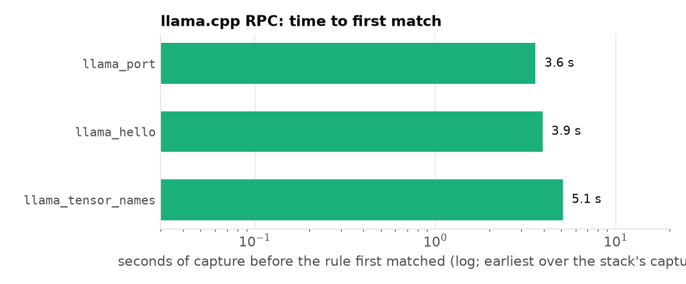
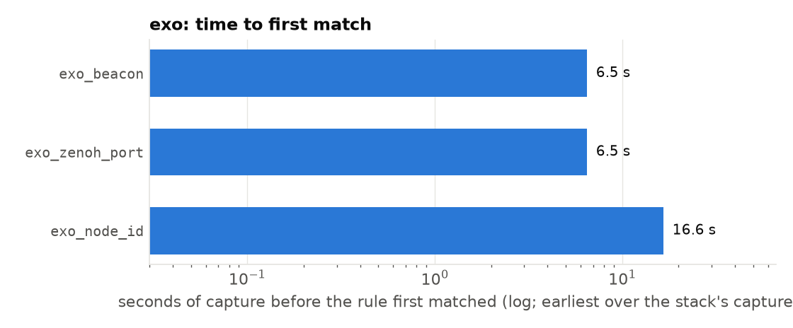
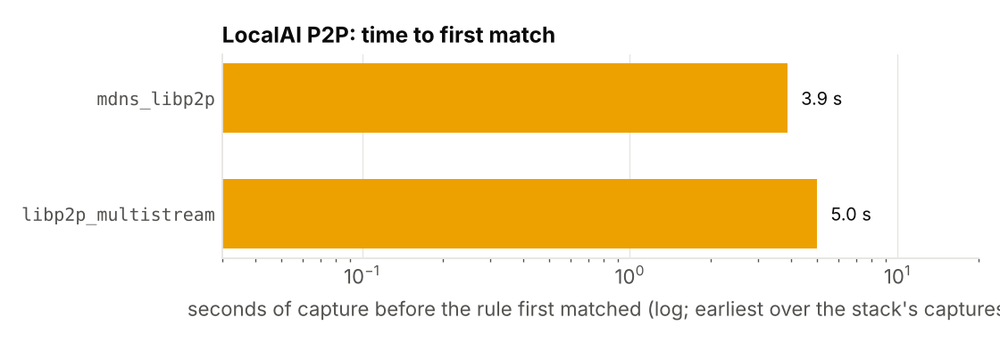

| stack | rule | first match, s from capture start | what it needed |
|---|---|---:|---|
| exo | `exo_beacon` | 6.48 (3.6 s after the nodes start) | one 20-byte UDP datagram: `45 58 4F 00` to `[ff12::e0a1:de89]:52413` |
| exo | `exo_zenoh_port` | 6.48 | TCP on 52414 (port only; the key expressions are not in a connection's first bytes) |
| exo | `exo_node_id` | 16.57 | `GET /node_id` on 52415 |
| llama.cpp | `llama_port` | 3.78 | TCP on 50052 |
| llama.cpp | `llama_hello` | 4.16 (0.5 s after `cluster.sh main`) | the 33-byte HELLO, on the wire as three segments of 1, 8 and 24 bytes |
| llama.cpp | `llama_tensor_names` | 5.36 | `blk.N.` names in the weight upload |
| LocalAI | `mdns_libp2p` | 3.89 | an mDNS answer carrying `dnsaddr=/ip4/…/p2p/12D3KooW…` |
| LocalAI | `libp2p_quic_alpn` | 4.19 | two client QUIC Initials of 1200 B whose ClientHello offers ALPN `libp2p`, no SNI |
| LocalAI, DHT on | `libp2p_multistream` | 5.01 | `/multistream/1.0.0` then `/tls` or `/noise`, on TCP to a public peer |
| background | none of the stack rules | | `mdns` fires and is classed ordinary |

exo and llama.cpp are identified from one packet each, at the first second their nodes
speak. exo's beacon repeats every second from every node, so a capture that starts at any
moment has it within a second; the three beacon sources give the node count at once.
llama.cpp's HELLO is per connection, and there are many: the main host opens about 15
short connections to each rpc host at load (the dispatcher cache holds them by `weak_ptr`,
`ggml-rpc.cpp:708-723`), each with a HELLO, each preceded by a DNS lookup of the rpc host's
name (`gethostbyname` per connection: 32 lookups in 1.3 s at every start). Between
connections the frame grammar still holds: every message is a 1-byte, 8-byte, n-byte
segment triplet (`send_rpc_cmd`, `ggml-rpc.cpp:372-386`, with `TCP_NODELAY`), and the
weight upload carries tensor names in ASCII.

LocalAI is identified as **libp2p**, not as LocalAI. The mDNS records name the protocol
(`/p2p/` multiaddrs) under a random 43-character label. The tunnels are QUIC
(`Redirecting 127.0.0.1:… to /ip4/…/udp/…/quic-v1` in the main node's log), so there is
no plaintext multistream handshake on the LAN, but the TLS ClientHello is there, inside
the first packets: a QUIC Initial is encrypted with keys derived from the client's
connection id and a published salt (RFC 9001 §5.2), which any observer can do. Every
pair of nodes opens its connection with two client Initials whose ClientHello offers
ALPN `libp2p` and no SNI (`libp2p_quic_alpn`, 0.3 to 0.4 s after the first mDNS record
in each LocalAI capture). It takes two because the ClientHello is about 1.5 KB, most of
it a post-quantum key share (X25519MLKEM768, read from the pcap by hand). After it,
nothing is readable. With the DHT on, the plaintext multistream handshake appears on
2240 TCP connections to public peers, and the QUIC ClientHello on 2493 UDP flows: the 6
between our nodes, 2237 to public peers and 250 to private addresses other peers
advertised, none of which answered (the split read from the report by hand). The loopback capture inside the main node shows the
llama.cpp signatures unchanged (`llama_hello` at 601.9 s, `llama_tensor_names` at
602.0 s, the first request), which is what the overlay hides.

What each headline capture looks like as a whole: one row per pair of hosts and kind of
traffic, every connection a bar, the data plane in the stack's hue:


Against the background set (696 flows, 621 s, all generators running) no stack rule
matched: `exo_beacon`, `llama_hello`, `llama_frames`, `llama_tensor_names` and
`libp2p_multistream` have no false positives in this set, and the mDNS announcer is
classed ordinary because its records carry no `/p2p/`.

## 3. Timing and size: what survives without payload

### Idle

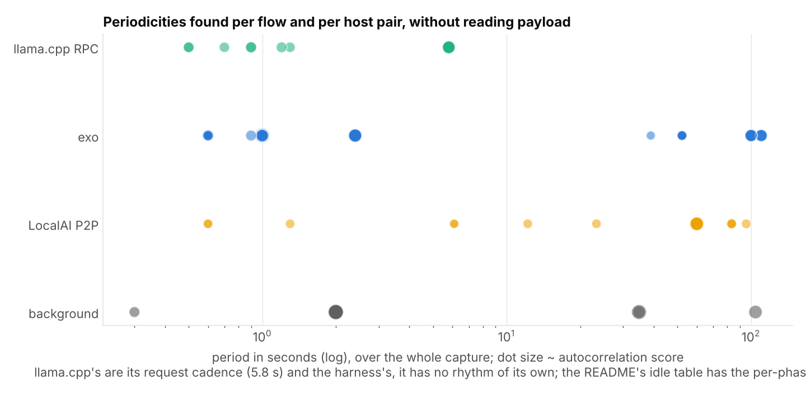

| stack | what repeats when nothing is requested | found by the rhythm rule |
|---|---|---|
| exo | beacon 1 s per node (score 0.99 to 1.0); `NodeGatheredInfo` 1 s on zenoh; `GET /node_id` probes about once a second per pair (1726 to 1828 connections per pair in 69 min): the 10 s cycle of the source (`worker/main.py`, `net_profile.py` at bc412e2) probes every interface address of every peer, and the IPv6 ULA addresses refuse (SYN, RST), so each cycle retries them three times a second apart; a 100 to 110 s component on every zenoh pair whose origin is not identified | 1.0 s on every beacon flow and zenoh pair; the 5 s election heartbeat is not among the top four, masked by the 1 Hz traffic |
| llama.cpp | nothing: zero packets on the RPC connections for 600 s | nothing to find |
| LocalAI | ~1 exchange per second of 115 B / ~1.6 KB per main-worker pair on the QUIC tunnels (0.3 to 0.5 MB per direction in 600 s; from the pcap by hand), mDNS every 23.3 s per node (cv 0.05), worker `LastSeen` every 20 to 30 s | a 6.1 s peak at score 0.2; the 10, 20 and 60 s intervals of the source are not visible on the wire |
| background | the UDP ping every 2.0 s (score 0.97 to 0.98) as a host-pair rhythm across its 304 one-packet flows; the download every 34.8 s; mDNS every 2 s | as stated |

### Generation

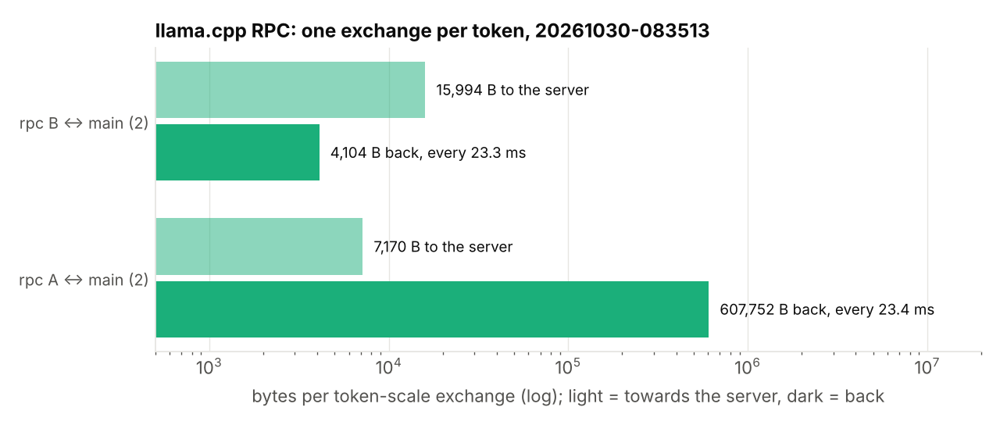
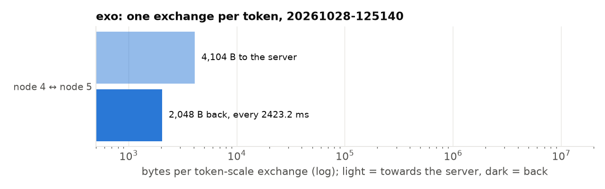
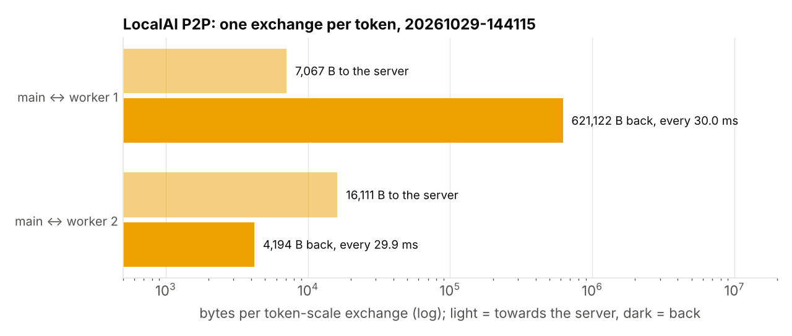

| stack | flow | exchanges per request | period | bytes to the host | bytes back | what the sizes are |
|---|---|---:|---:|---:|---:|---|
| llama.cpp | main → rpc-0 | 30 | 23.3 ms | 15 994 | 4104 | 7 SET_TENSOR + graph + GET_TENSOR; hidden state 1024 × 4 B back |
| llama.cpp | main → rpc-1 | 30 | 23.4 ms | 7170 | 607 752 | logits: 151 936 × 4 B + 8 |
| exo | ring neighbours, all three pairs | 30 | 2423 ms | 4104 | 2048 | activation 1024 × 2 B each way |
| LocalAI | main → worker-1, QUIC | 30 | 29.9 ms | 16 111 | 4194 | the same hidden state plus ~2% QUIC framing |
| LocalAI | main → worker-0, QUIC | 30 | 30.0 ms | 7067 | 621 122 | the same logits plus ~2% QUIC framing |

The decode rate read from the exchange interval matches the client's within 3% on
llama.cpp (23.3 ms against 23.5 ms per token), exo (2.42 s against 2.45 s) and LocalAI
(30.0 ms against 30.8 ms). The model's hidden size and vocabulary are on the wire: the
4104-byte and 2048-byte legs are the 1024-wide hidden state in F32 and bf16, the 607 752
and 621 122-byte legs are the vocabulary times four. Encryption adds about 2% to each
leg (4104 to 4194 B, 607 752 to 621 122 B), which leaves both readings intact.

The topology differs and is visible: llama.cpp and LocalAI are a star (the rpc hosts never
exchange a packet with each other; LocalAI's workers exchange only overlay gossip, 0.6 MB
over a run); exo is a ring, and with three nodes a triangle, every pair on a random port
in 49153 to 65535 chosen at placement, silent between requests. llama.cpp's heavy leg
sits on the host that holds the output layer; exo's hops are symmetric.

A prompt change on llama-server moves KV state over the wire: with distinct prompts every
request began with transfers from the rpc hosts to the main host (4.7 and 4.6 MB for a
63-token context, 138 and 113 MB after ~2100 tokens, counted from the request to the
first token; from the pcap by hand), the server's prompt cache saving the
slot's state to host RAM (`prompt_save`, `tools/server/server-context.cpp:342-370`, on by
default at `cache_ram_mib = 8192`). A long prompt costs its prefill once and its KV
state again at every slot change, and on an RPC split the state crosses the wire.

Load is a one-way burst the size of the slice: llama.cpp 252 MB and 384 MB (the whole
Q8_0 file; the main host weighted 0 keeps nothing, the tied embedding sits on the last
host), LocalAI 258 MB and 392 MB in ~1.5 s (the duration from the pcap by hand) with the
embeddings kept on main. exo loads from
each node's disk and puts nothing on the wire at placement except its control plane.

On the background set no flow was generation-like: the download, the stream and iperf
are one-directional at the exchange scale, the ping and mDNS carry no activation-sized
leg. Within a swarm the rule does fire on things that are not decode: exo's 1 Hz
`NodeGatheredInfo` (2079 B with a 522 B reply) in idle, and with the DHT on, LocalAI's
exchanges with public peers (38 phase-flows on 33 flows: 18 every 4 to 5 s of ~3.0 KB / 1.4 KB,
16 every 10 s of ~1.5 KB / 6.9 KB, 4 at 0.2 to 0.4 s). Both are the swarm's
own traffic, but a rule that reads only sizes and timing cannot tell a slow decode from a
regular status exchange of the same size.

### Node loss from outside

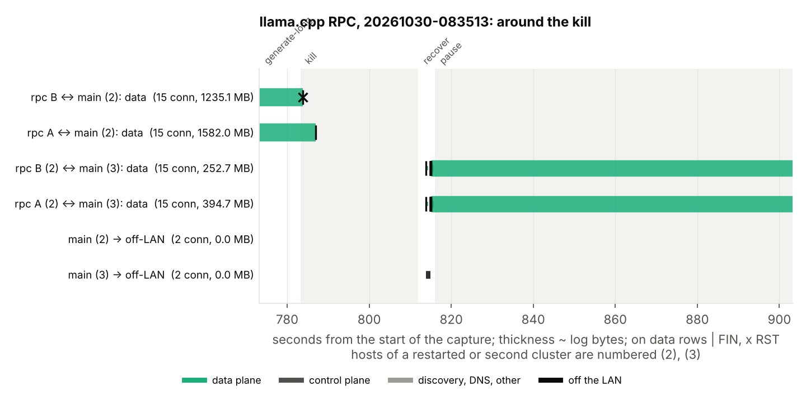
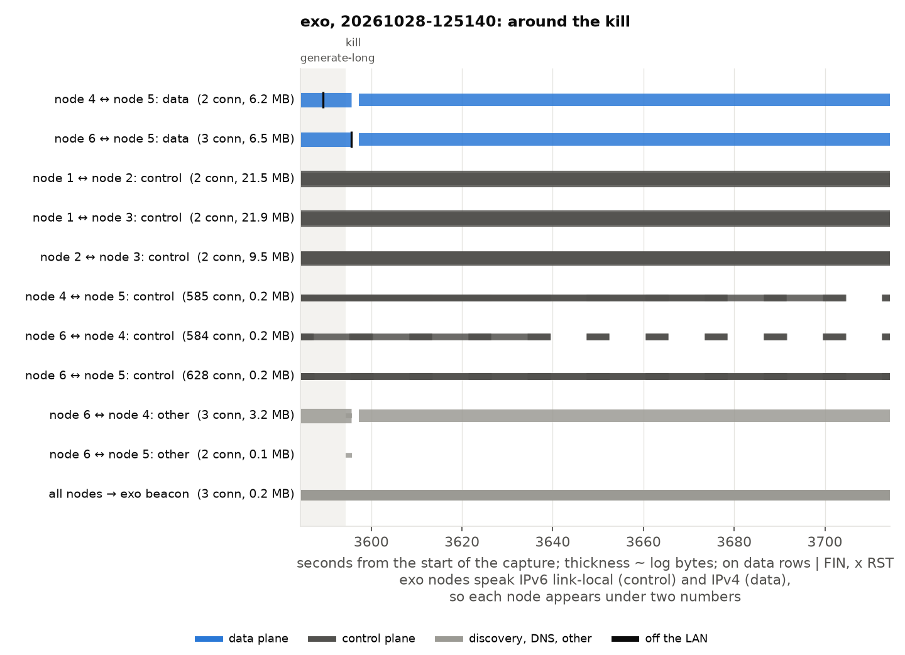
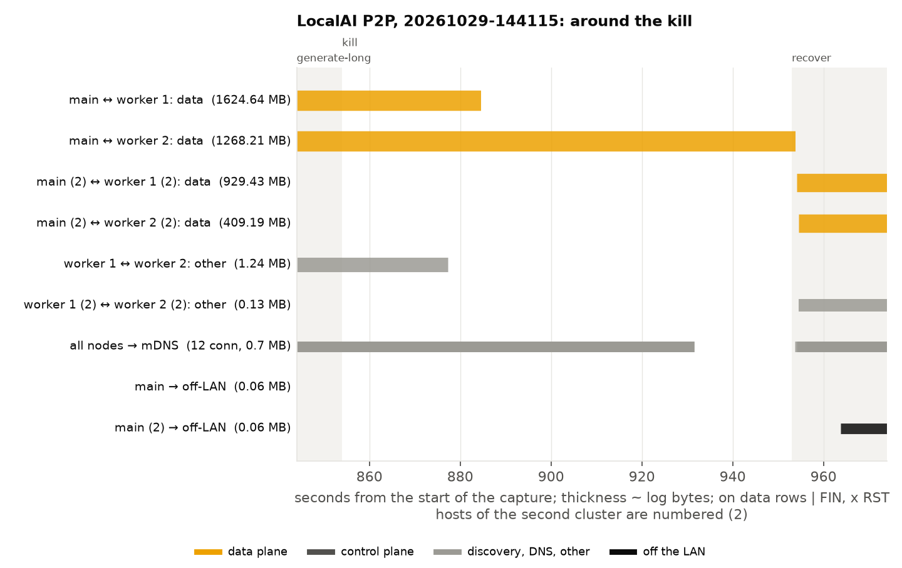

| stack | killed mid-request | paused mid-request | what the client saw |
|---|---|---|---|
| llama.cpp | RST from the dead host 0.07 s after the kill; the main host FINs the other rpc host 3.1 s later | not a packet on either RPC connection for 120 s; 2.4 MB from the paused host on resume | the stream ends 3.2 s after the kill, with that FIN, after 12 tokens (whether with an in-band error is not recorded: the harness skipped such events then); no token for 120 s during the pause, then the harness gave up |
| llama.cpp, killed while idle | one FIN from the dead host; no reaction, probe or reconnect from the main host | | |
| exo | the node's beacon stops at once; `InstanceDeleted` 15 s later; new ring flows on new ports after re-placement (175 s) | | the Experiment 3 numbers |
| LocalAI | the node goes silent; main sends a few small QUIC probes a second for 30 s, then nothing; the next request reloads ~650 MB to the surviving worker | the same, 30 s | after 30 s an in-band `server_error` event and `[DONE]` on a stream that began with HTTP 200 (`Stream ended with error` in the main node's log; a client that reads only `choices`, as our harness did, sees a truncated answer that looks complete); 30 s is QUIC's idle timeout (go-libp2p v0.48.0 sets no `MaxIdleTimeout` in its `quic.Config`, `p2p/transport/quicreuse/config.go:9-20`, so quic-go v0.59.0's `DefaultIdleTimeout` of 30 s applies, `internal/protocol/params.go:100`; keepalives every 15 s), not LocalAI's 40 s ledger window |

The timings in this table are read from the pcaps and the container logs by hand; the
client's side is in the request logs, which until 2026-11-02 did not keep in-band error
events (`requests.py` now records them and the finish reason).

## 4. What leaves the LAN

| stack | with the defaults | bytes | when |
|---|---|---:|---|
| llama.cpp (`-hf`) | two TLS connections to Hugging Face's CDN (CloudFront) per main-host start, even with the model cached; nothing from the rpc hosts | 2.6 KB up, 14 KB down | every start, within 0.6 s of the first RPC connection |
| exo | the first start of a cluster whose image was just built: 591 connections to Hugging Face's CDN, 12.4 MB, in the start and place phases (`20261028-083159`); the next cluster start, same image, none in 69 min (`20261028-125140`) | 12.4 MB once | first start |
| LocalAI, DHT off | one TLS connection to `index.localai.io` (Cloudflare) per main-node start | 4.4 KB up, 60 KB down | start and recover |
| LocalAI, DHT on | an IPFS bootstrap node on TCP 4001 1.1 s after start; over 728 s all three nodes of each cluster talk to 1860 public hosts on UDP and TCP 4001, and dial the private LAN addresses other peers advertised (`192.168.x`, `169.254.x`) | 58 MB up, 72 MB down, ~180 KB/s | continuously; 895 public hosts in connections opened during the 300 s idle |
| LocalAI v4 before `cluster.sh` turned it off | a gallery warm-up fetches ~2 GB from Hugging Face for ~5.5 min after every start (`LOCALAI_VRAM_WARM_LIMIT`), plus `index.localai.io` and `raw.githubusercontent.com`, and the importer re-queries Hugging Face for a `huggingface://` model at every start | ~2 GB | every start |

The bytes and host counts are `evaluate.py`'s off-LAN table (per phase, by the phase a
connection opened in, and a total per capture); the 1.1 s, the dialled private addresses
and the warm-up row are read from the pcaps and logs by hand.

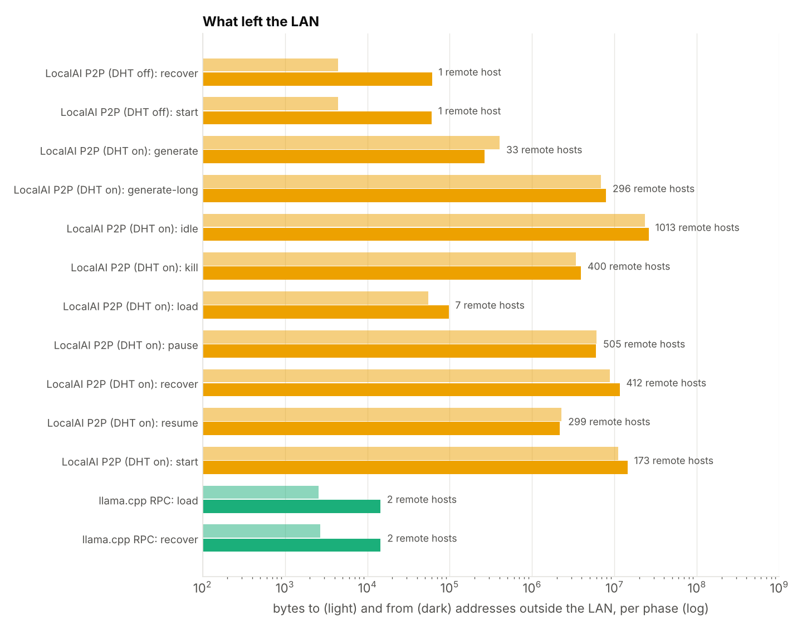


For the home-router vantage this is the whole story of a swarm on one LAN: llama.cpp and
exo show the router nothing but a manifest check, LocalAI with its defaults shows it a DHT
node. For a swarm across homes, each box's share of §3 is its egress, and the DHT traffic
is the same as any IPFS node's.

## 5. Predictions against measurements

The fifteen predictions in [STUDY.md](STUDY.md), as written before the first capture.

| # | prediction | measured | verdict |
|---|---|---|---|
| 1 | exo identified by its first beacon, within 1 s, no false positives | 20-byte `45 58 4F 00` to the group, 3.6 s after the nodes start, every second thereafter; none in the background set | right |
| 2 | node count from beacon sources within 2 s, master within 10 s | three sources at once; the master not identified by the rules (the zenoh key expressions are not in a connection's first bytes) | partially |
| 3 | exo idle: 1 s, 5 s, 10 s, ~2.5 s periodicities | 1 s at score 1.0; the probes run at ~1 s, the source's 10 s cycle plus three tries a second apart on the refused ULA addresses; 5 s not among the top four; a 100 to 110 s component unexplained | partially |
| 4 | exo generation: new TCP flows on 49153 to 65535 between ring neighbours, ~2 KiB per hop at 0.4 Hz | 51664 (then 65080 after re-placement), all three pairs, 4104 B / 2048 B every 2.42 s; the 2048-token prefill never ran: exo's 90 s no-progress watchdog (`RUNNER_STALL_TIMEOUT`, `supervisor.py:64`) cancels any prompt over ~35 tokens at this speed | right on the data plane, the long prefill unobtainable |
| 5 | llama.cpp identified by the 33-byte HELLO on 50052; frame grammar and tensor names otherwise | HELLO at 4.2 s as 1 + 8 + 24 bytes; grammar and names as predicted; no false positives | right, with a correction of form |
| 6 | llama.cpp invisible when idle | zero payload on the RPC flows for 600 s | right |
| 7 | star; ~4 KiB each way per host, ~600 KB logits back from the last host; constant within 5%; rate within 10% | star; 16 KB / 4104 B and 7170 B / 607 752 B; cv 0.0 at the token scale; rate within 3% | right on shape and rate, the small legs 2 to 4 times larger (7 SET_TENSOR per token) |
| 8 | load moves ~320 MB to each host | 252 MB and 385 MB, the whole file, split unevenly by the tied embedding | right in total, wrong in split |
| 9 | LocalAI shows the libp2p handshake and nothing readable after; loopback shows llama.cpp unchanged | the tunnels are QUIC: no plaintext multistream on the LAN (it appears only on TCP to DHT peers), but the predicted ClientHello with ALPN `libp2p` and no SNI opens every tunnel, inside two QUIC Initials anyone can decrypt; nothing readable after; llama.cpp unchanged on loopback | right, with a correction of form |
| 10 | LocalAI's per-token structure equals llama.cpp's plus a constant overhead; decode rate readable | 621 122 B per token on the output-layer worker and 4194 B on the other (+2% each), 30.0 ms against 30.8 ms at the client | right |
| 11 | LocalAI idle: 10, 20, 60 s periodicities; mDNS with a random label and `/p2p/` TXT | mDNS as predicted, every 23.3 s; the encrypted overlay shows ~1 exchange/s and a weak 6 s peak, not 10/20/60 s | partially |
| 12 | LocalAI leaves the LAN by default (DHT bootstrap on 4001 within 60 s); exo and llama.cpp send nothing after the model is on disk | DHT: a bootstrap node at 1.1 s, 131 MB over 728 s; with DHT off still `index.localai.io`; llama.cpp `-hf` checks the CDN at every start; exo 591 connections at its first start and none at the second | right for LocalAI and for exo after its first start, wrong for llama.cpp `-hf` |
| 13 | a size-and-timing rule flags generation in all three within 10 tokens and not the video or the download | llama.cpp and exo flagged; the background set clean; LocalAI flagged on both tunnels in `generate` once QUIC acknowledgements and its per-request preamble (~26 round trips 0.4 ms apart) stopped splitting the exchanges; false positives inside the swarms on exo's status messages and, with the DHT on, on 33 flows to public peers | partially |
| 14 | node loss visible: exo's beacon stops then re-placement; llama.cpp RST on kill, nothing on pause | as predicted, except a kill with no request in flight gives a FIN, not a RST | right, with a condition |
| 15 | the static rules fail only to a port change | not tested (no stack was modified); the port rules and byte rules are separate in `signatures.py` | not tested |

## 6. Limitations

One host, one bridge, a near-ideal network: the per-token rhythm here has a spread of
zero, and a real LAN or WAN adds jitter the rules were not tuned against. Small models:
the sizes that identify hidden size and vocabulary scale with the model, the rules do
not depend on them. The rhythm rules are judged per harness phase, which a defender does
not have; across a whole capture the same rules miss (llama.cpp's full run, all phases
mixed, was not flagged before the per-phase change). The generation rule fires on
status exchanges of activation size (exo's 1 Hz info, DHT keepalives); it separates a
swarm from the background set, not decode from the swarm's own control plane. With the
DHT on it matched 38 phase-flows on 33 QUIC flows to public peers, where no decode goes:
34 of them in `idle`, 16 at exactly 10 s (the period of LocalAI's DHT discovery,
FINDINGS-wire §3), 18 at about 5 s, 4 at 0.2 to 0.4 s. A period cap would remove most
of them but sit just above exo's 2.4 s decode, and keeping the rule to flows inside the
LAN would give up the swarm across homes of §3; the rule is left as it is. Prediction
15 (evasion by port change) was not run. exo's long prefill cannot be observed as shipped.
LocalAI was captured at v4.12.1 while the source was read at master 35224b8. The QUIC
decoder reads version 1 Initials only (not QUIC v2, RFC 9369), and the background set
carries no QUIC at all, so `libp2p_quic_alpn` was not tested against ordinary QUIC such
as a browser's HTTP/3; it needs `libp2p` in the ALPN, which HTTP/3 does not offer. The
background set is five
generators, not a home network.

## Conclusion

### What the result settles

In the three stacks that were tested I found that the shard-to-shard traffic of all three
can be fingerprinted against background noise (§2). The capture needed for a fingerprint
is small. For exo this is done the fastest. It sends a 20-byte datagram (`45 58 4F 00`) at
1 Hz, so any 1 s capture would already show it. The beacon sources also give the node
count, which could be useful in stopping the swarm (§2). In llama.cpp there is a 33-byte
HELLO (1 + 8 + 24 bytes) on the first connection. This is repeated on about 15 connections
per rpc host at every load. It also exposes the tensor names in ASCII in the upload (§2).
With LocalAI the experiments exposed it in the mDNS records or the ALPN libp2p ClientHello
inside the first two QUIC Initials of every tunnel (§2). The Initials can be decrypted by
anyone, since their keys derive from the client’s connection id (RFC 9001 §5.2).

The experiment showed that no stack rules got triggered in the background noise set (696
flows, 621 s, five generators; §2). Also none of the flows matched the generation-like
traffic rhythms (§3). Using encryption may hide the network data, but it does not hide the
model or the decode rate. LocalAI's tunnels carry nearly the same per-token legs as
llama.cpp (4104 to 4194 B, 607 752 to 621 122 B); the hidden size (1024 × 4 B) and the
vocabulary (151 936 × 4 B) are both readable from the sizes (§3). By looking at the
exchange interval the findings showed that it's possible to deduce the decode rate
accurately within 3% on all three stacks (§3). Encryption cost LocalAI nothing in
exposure: the tunnel added 2% to each leg and left the hidden size, the vocabulary and the
decode rate readable (§3). A swarm that wants to hide has to change its shape, not its
cipher.

The topology of the stacks is visible without payload. Both llama.cpp and LocalAI use a
star, while exo sets up a ring on random ports chosen at placement (§3). The node loss was
visible from the outside: llama.cpp's RST within 0.07 s of a kill and a FIN 3.1 s later;
exo's beacon stops at once and new ring flows appear after re-placement; LocalAI probes
for 30 s (QUIC's idle timeout) then goes quiet and reloads ~650 MB on the next request
(§3).

Under default settings all three of the stacks made connections outside the LAN, which can
be scanned for on the router (§4):
- llama.cpp `-hf` checks Hugging Face's CDN at every start even with the model cached
  (2.6 KB up, 14 KB down).
- exo 12.4 MB over 591 connections to Hugging Face's CDN at its first start, then silent.
- LocalAI `index.localai.io` at every start and, with the DHT on, 1860 public hosts on
  port 4001, 58 MB up and 72 MB down in 728 s.

For the operator the same facts are the swarm's exposures:

- llama.cpp puts nothing on the wire while idle (zero packets in 600 s) and is visible
  only while it serves (§3);
- exo and LocalAI never go quiet, so they are visible at any moment (§3);
- on an RPC split a prompt change moves the KV state between hosts, 4.6 MB at 63 tokens
  and 113 to 138 MB at ~2100 (§3).

### What it does not settle

I only tested three stacks, with unmodified code and default settings. I'm certain I could
make it more difficult to be detected with a few changes in code, or changing the ports
(§5, prediction 15). The rules were written with that in mind: the port part and the byte
part of every signature are separate (signatures.py), so a port change defeats only the
port rules, and the byte rules fall only to a change in the framing itself (§2). This was
left out on purpose in this public experiment. This could be a good experiment for
in-house red-team experiments. I chose the most simple set up with one host, one bridge
and zero jitter; the rhythm rules were not tuned against a real LAN or WAN, and they are
judged per harness phase, which a defender does not have (§6). This would be my next step
if I take this experiment one step further.

The generation rule manages to clearly separate the swarm from the background noise. It
also fires on exo's 1 Hz status messages and on 33 DHT flows to public peers, neither of
which is decode (§3, §6). LocalAI is identified as libp2p, not as LocalAI: the mDNS
records, the ALPN and the DHT traffic are the same as any libp2p application's, and with
the DHT on it is indistinguishable from an IPFS node at the router (§2, §4). The swarm
shows only in the rhythm of its tunnels.

I only used a small model (Qwen3-0.6B) for the experiment (§6). Since the identifying
sizes will scale with the model used, the rules do not use them: the generation rule looks
for a regular two-way exchange with one leg over 2 KB, never for a particular size.

Of the fifteen predictions in §5:

Six held, three of them with a qualification noted there:
- exo's beacon within a second, with no false positives (1)
- exo's ring on random ports between neighbours (4); the long prefill could not be
  observed
- llama.cpp silent when idle (6)
- llama.cpp's star with ~600 KB of logits from the last host at a steady rate (7); the
  small legs came out 2 to 4 times larger than predicted
- LocalAI's per-token structure equal to llama.cpp's plus a constant overhead (10)
- node loss visible from outside (14); a kill with no request in flight gives a FIN, not a
  RST

Two were right in substance and wrong in form:
- llama.cpp's HELLO is 33 bytes but arrives as three segments of 1, 8 and 24 (5)
- LocalAI's handshake is not the plaintext multistream I expected but the same ClientHello
  inside two QUIC Initials, which the public Initial keys open (9)

Four were right in part:
- exo's node count came from the beacons at once, but the master was not identified (2)
- exo's 1 s period was there and its 5 s election heartbeat was not, with a 100 to 110 s
  component I cannot explain (3)
- LocalAI's mDNS was as predicted; its 10, 20 and 60 s intervals were not visible through
  the overlay (11)
- the generation rule flagged all three stacks and nothing in the background set, but also
  exo's status messages and the DHT's exchanges with public peers (13)

Two were wrong in a part that matters:
- the load split (8): 252 and 384 MB instead of two equal halves, because the tied
  embedding sits on the last host
- llama.cpp leaving the LAN (12): it does, at every start with `-hf`, even with the model
  cached, where I had predicted nothing once the model is on disk

One was not run:
- evasion by a port change (15)

### Whether the work continues

The experiments have been largely successful and have taught me a lot about how to set up
distributed swarms, their weaknesses and the tracks and traces they leave behind. Any
further research on this exact topic will probably be kept private to ensure that it is
not used to make a future real swarm more resilient or hidden from the defender or show an
operator where the rules are weak. Although the findings of all the experiments showed
mainly that the defender had the upper hand, I think this is mainly due to perfect
information. I knew the ports, the bridge, the host roles and the phase boundaries, and
the rules were judged per phase. A real defender has a pcap with no markers and on a whole
capture with no phase markers the same rules missed llama.cpp's run (§6). For any future
work the focus should be to find a rule that works on an unmarked capture. Actually
locating a real swarm would come with its own difficulties that I'm looking forward to
tackling.

## Repository

- `FINDINGS-wire.md`: discovery, transport, framing, periodicity and data-plane sizes of
  each stack, read from source with file:line, and the corrections the first capture
  made. Start here.
- `STUDY.md`: the question, vantage points, what is captured, the fifteen numbered
  predictions, method, out of scope.
- `STYLE.md`: the series' style, copied in unchanged.
- `capture/`: `capture.sh` (tcpdump on a rootless Podman network's bridge, size and
  SHA-256 at stop), `phase.sh` (timeline markers on the same clock as the pcap),
  `requests.py` (streaming requests to any OpenAI-compatible endpoint), `run_llamacpp.sh`,
  `run_llamacpp_pause.sh`, `run_exo.sh`, `run_localai.sh`, `run_localai_load.sh` and
  `run_background.sh` (one scenario each, phases marked).
- `exo/`, `llamacpp/`: the Experiment 3 `Containerfile` and `cluster.sh`.
  `localai/cluster.sh`: main node plus P2P workers at v4.12.1, pinned by digest, with
  `tunnels`, `killproc`, `pause`, `resume`.
- `background/run.sh`, `background/mdns.py`: the ordinary-traffic generators.
- `analysis/`: standard library only. `pcap.py` (reader), `flows.py` (flow table with TCP
  sequence accounting), `signatures.py` (byte and port rules per stack), `rhythm.py`
  (periodicities per flow and per host pair, exchanges at every scale, the generation
  test), `quic.py` (QUIC v1 Initial decryption and the ClientHello's ALPN and SNI, with
  AES-128-GCM written out), `classify.py` (apply everything to a capture and report what
  could be said, and when).
- `evaluate.py`: the tables in §2 to §4 from the committed reports. `figures.py`: the
  figures, one per finding and per stack, from the same reports and timelines; `figures/`.
- `tests/synthetic.py`: a synthetic pcap with the predicted shapes, to exercise the
  analysis without a cluster. It is not evidence. `tests/test_quic.py`: `quic.py`
  against the AES, GCM and RFC 9001 Appendix A vectors, and round trips through
  `tests/quicgen.py`, which builds client Initials for both.
- `captures/<stack>/<stamp>.*`: per capture, the timeline, the request log, the
  `/api/p2p` samples and container logs where taken, the pcap's size and SHA-256, and
  the `classify.py --json` report; the pcaps are not committed (`.gitignore`).

### Reproducing

Analysis needs Python 3.10 or later and nothing else; `figures.py` needs the matplotlib
pinned in `requirements.txt`:

```
python3 -m unittest tests.test_quic
python3 -m tests.synthetic /tmp/syn.pcap && python3 -m analysis.classify /tmp/syn.pcap
python3 evaluate.py                         # the tables, from the committed reports
python3 figures.py                          # the figures, from the committed reports
```

Captures need the host from Experiment 3 (i5-14600K, rootless Podman, `tcpdump`, the
`exo-node` and `llamacpp-rpc` images built from `exo/Containerfile` and
`llamacpp/Containerfile`; LocalAI pulls its image and backend by digest):

```
capture/run_llamacpp.sh 600                 # ~16 min; writes captures/llamacpp/<stamp>.*
capture/run_llamacpp_pause.sh               # the hang case alone, with the resume
RECOVERY=../distributed-inference-recovery capture/run_exo.sh 600    # ~70 min: exo decodes at 2.4 s/token
capture/run_localai.sh 600                  # ~18 min; LOOPBACK=1 adds tcpdump on each container's lo (~7 GB)
DHT=1 capture/run_localai.sh 300            # prediction 12
capture/run_background.sh llama-net 600     # the ordinary-traffic set
python3 -m analysis.classify captures/<stack>/<stamp>.pcap --timeline captures/<stack>/<stamp>.timeline.csv --json captures/<stack>/<stamp>.report.json
```

`LOOPBACK=1` runs the host's `tcpdump -i lo` inside each container's network namespace
(`podman unshare nsenter --net=/proc/<pid>/ns/net`; the LocalAI image has no tcpdump), one
`<stamp>.<container>[.2].lo.pcap` per cluster start, hashed at the end like the bridge
capture. The LocalAI scripts write each node's log with the swarm token redacted.

The pcaps are not in the repository. On the capturing host (2026-11-02), all but
`llamacpp/20261027-150104` and `background/20261027-163430` are kept, so every other
report can be regenerated from its pcap; the hashes are in the `.pcap.sha256` files.

### Status

- [x] wire protocols read from source (exo bc412e2, llama.cpp 74bca39, LocalAI 35224b8; captured at v4.12.1)
- [x] predictions written (STUDY.md)
- [x] capture harness and analysis; captures of llama.cpp, exo, LocalAI (DHT off and on, with loopback), background
- [x] §1 to §6 written from the reports; the predictions scored
- [x] LocalAI reports regenerated with the QUIC exchange grouping
- [x] the generation rule's false positives on the DHT's exchanges with public peers: kept as a limitation (§6)
- [x] a QUIC Initial decoder for the ALPN `libp2p` signature (prediction 9 on QUIC); LocalAI reports regenerated
- [x] the headline llama.cpp capture rerun (20261030-083513) and classified on the current rules
- [x] introduction and conclusion

## Acknowledgement

The source reading, the capture harness and the analysis were developed together with
Claude (Anthropic). The questions, the framing, the captures and the conclusions are
Naithan Weigh's.
