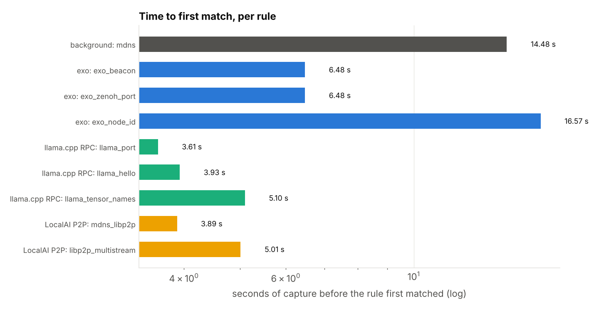
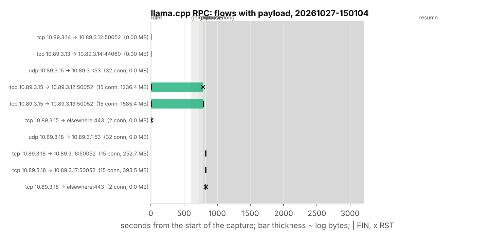
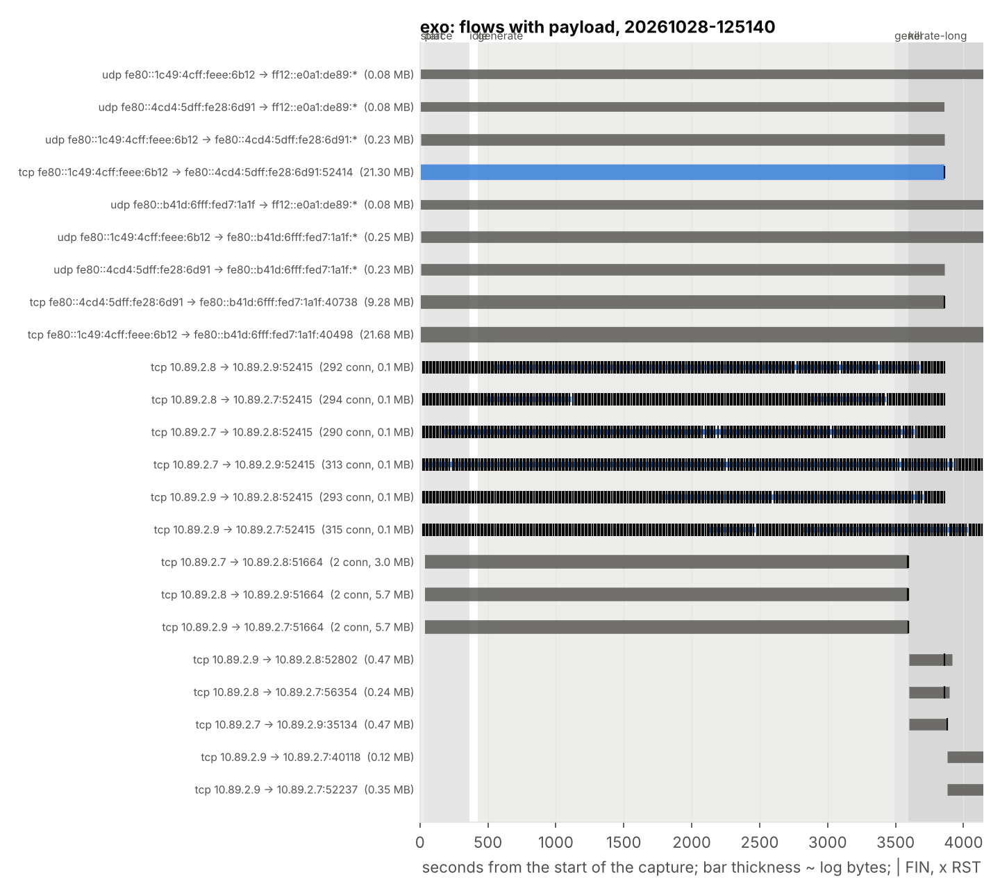
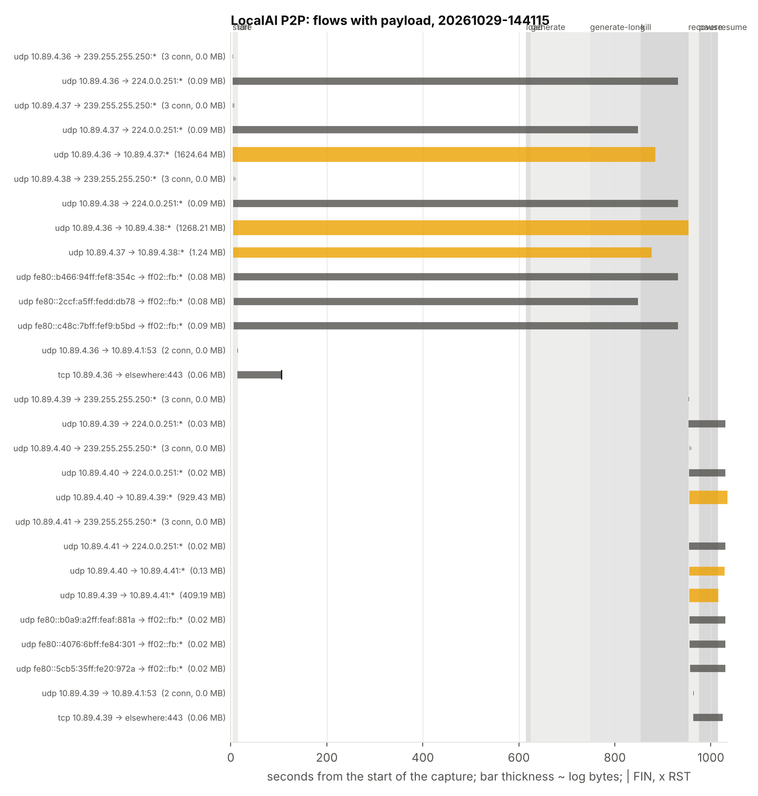
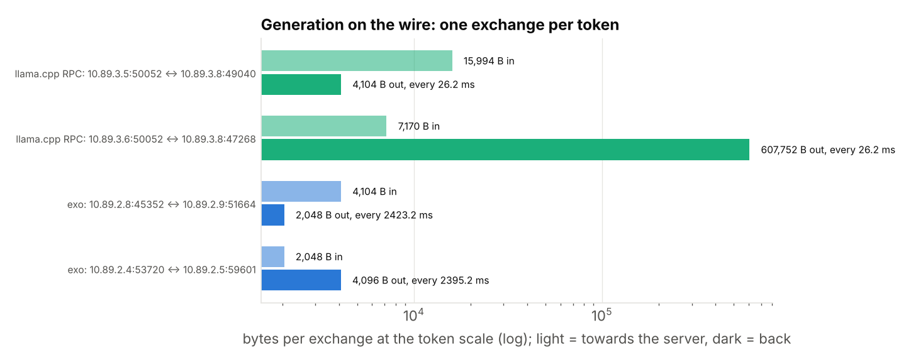
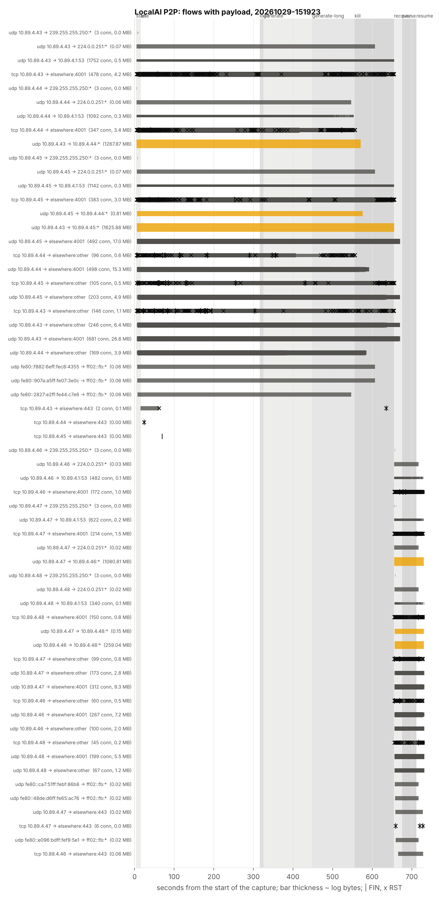

# distributed-inference-fingerprint

<!-- INTRO (Nat): the question (the essay's "can shard-to-shard traffic be fingerprinted
against background noise"), where it came from, the two readers, scope (measure and
classify with readable rules; no evasion; vLLM dropped, LocalAI added, see STUDY.md), the
one-sentence outcome once there is one, who did what, where the numbers come from
(analysis/classify.py from the committed reports and timelines). -->

Experiment 4 of the distributed-inference resilience work: what a swarm looks like on the
wire, and how little capture a defender needs to recognise it. Three stacks, read from
source first ([FINDINGS-wire.md](FINDINGS-wire.md)), fifteen predictions written before
any capture ([STUDY.md](STUDY.md)), then packet captures of exo, llama.cpp RPC and
LocalAI's P2P mode on a rootless Podman bridge, with ordinary traffic captured the same
way as the negative set. Earlier experiments: the model and the cut experiment in
[distributed-inference-resilience](https://github.com/thenaithan/distributed-inference-resilience),
the measured recovery cost in
[distributed-inference-recovery](https://github.com/thenaithan/distributed-inference-recovery).

## 1. What is measured

Three stacks on one host (i5-14600K, rootless Podman, EndeavourOS), each as a cluster of
containers on its own Podman bridge, with `tcpdump` on the bridge inside the rootless
network namespace (`capture/capture.sh`): the vantage of a passive tap on the LAN segment
the nodes share. The stacks:

| stack | version | cluster | model |
|---|---|---|---|
| llama.cpp RPC | 74bca39 | 2 `ggml-rpc-server` hosts holding one layer slice each, 1 `llama-server` main host | `ggml-org/Qwen3-0.6B-GGUF` Q8_0 |
| exo | bc412e2 | 3 nodes, pipeline sharding, MLX CPU backend, IPv6 network | `mlx-community/Qwen3-0.6B-8bit` |
| LocalAI P2P, worker mode | v4.12.1 (ec92740), backend `v4.12.1-cpu-llama-cpp` | 1 main node, 2 `p2p-worker p2p-llama-cpp-rpc` workers sharing a token; DHT off, then on | `Qwen3-0.6B-Q8_0.gguf` from the same GGUF |

The source reading in [FINDINGS-wire.md](FINDINGS-wire.md) was made at LocalAI master
35224b8; the P2P paths it cites are the same at v4.12.1. vLLM is not here: with PP=2 on
one host its ranks share memory and nothing reaches a wire ([STUDY.md](STUDY.md)).

Each stack runs one scripted scenario (`capture/run_<stack>.sh`) with phase markers on
the capture's clock: start (discovery, links), idle (model loaded or workers attached,
no requests, 600 s), load (where the stack loads on first use), generate (20 requests of
30 tokens), generate-long (a ~2048-token prompt), then node loss (a worker killed 0.5 s
into a request, the cluster recreated, a worker paused, resumed). The ordinary-traffic set
(`background/run.sh`) runs on the same bridge with no swarm: an HTTP download every 30 s,
an MPEG-TS video stream over UDP, a 64-byte UDP ping every 2 s, an mDNS announcer every
2 s and a 30 s iperf3 run, all at LAN rates.

The analysis is `analysis/` (standard library only): flows from the pcap, then two kinds
of rule. **Byte and port rules** (`signatures.py`) match what source said each stack puts
on the wire: exo's beacon magic, group and ports; llama.cpp's HELLO, frame grammar, tensor
names and port; libp2p's multistream handshake, TLS ALPN and mDNS `dnsaddr` records.
**Timing and size rules** (`rhythm.py`) read no payload: periodicities of a flow or of a
host pair, and exchanges (a run of client segments answered by server segments) grouped
at every regular scale, judged per phase, with a "generation-like" test: at least ten
exchanges at a stable rate with stable sizes, data both ways, one leg of at least 2 KB.
`classify.py` applies everything to a capture and reports what could be said and at which
second of capture; `evaluate.py` prints the tables below from the committed reports.

Captures: nine with a swarm, three background. The headline ones are
`captures/llamacpp/20261027-150104` (600 s idle, kill and pause mid-request),
`captures/exo/20261028-125140`, `captures/localai/20261029-144115` (DHT off, with
loopback captures inside the containers) and `captures/localai/20261029-151923` (DHT on),
and `captures/background/20261028-081447`. Every capture after the first ran with no
kernel drops; the first (`25691027-122003`, a 1.7 GB pcap with tcpdump's default buffer)
dropped 7% of packets and its byte figures are from TCP sequence accounting.

## 2. Static signatures: how little capture identifies the stack



| stack | rule | first match, s from capture start | what it needed |
|---|---|---:|---|
| exo | `exo_beacon` | 6.48 (3.6 s after the nodes start) | one 20-byte UDP datagram: `45 58 4F 00` to `[ff12::e0a1:de89]:52413` |
| exo | `exo_zenoh_port` | 6.48 | TCP on 52414 (port only; the key expressions are not in a connection's first bytes) |
| exo | `exo_node_id` | 16.57 | `GET /node_id` on 52415 |
| llama.cpp | `llama_port` | 3.61 | TCP on 50052 |
| llama.cpp | `llama_hello` | 3.93 (0.3 s after the main host starts) | the 33-byte HELLO, on the wire as three segments of 1, 8 and 24 bytes |
| llama.cpp | `llama_tensor_names` | 5.10 | `blk.N.` names in the weight upload |
| LocalAI | `mdns_libp2p` | 3.89 | an mDNS answer carrying `dnsaddr=/ip4/…/p2p/12D3KooW…` |
| LocalAI, DHT on | `libp2p_multistream` | 5.01 | `/multistream/1.0.0` then `/tls` or `/noise`, on TCP to a public peer |
| background | none of the stack rules | | `mdns` fires and is classed ordinary |

exo and llama.cpp are identified from one packet each, at the first second their nodes
speak. exo's beacon repeats every second from every node, so a capture that starts at any
moment has it within a second; the three beacon sources give the node count at once.
llama.cpp's HELLO is per connection, and there are many: the main host opens about 15
short connections to each rpc host at load (the dispatcher cache holds them by `weak_ptr`,
`ggml-rpc.cpp:708-723`), each with a HELLO, each preceded by a DNS lookup of the rpc host's
name (`gethostbyname` per connection: 32 lookups in 1.3 s at every start). Between
connections the frame grammar still holds: every message is a 1-byte, 8-byte, n-byte
segment triplet (`send_rpc_cmd`, `ggml-rpc.cpp:372-386`, with `TCP_NODELAY`), and the
weight upload carries tensor names in ASCII.

LocalAI is identified as **libp2p**, not as LocalAI, and only through its discovery: the
mDNS records name the protocol (`/p2p/` multiaddrs) under a random 43-character label.
Its tunnels are QUIC (`Redirecting 127.0.0.1:… to /ip4/…/udp/…/quic-v1` in the main
node's log), so there is no plaintext multistream handshake and no plaintext TLS
ClientHello on the LAN: none of the libp2p byte rules match a tunnel flow. With the DHT
on, the plaintext multistream handshake does appear, on 2240 TCP connections to public
peers, none of them on the LAN. The loopback capture inside the main node shows the
llama.cpp signatures unchanged (`llama_hello` at 601.9 s, `llama_tensor_names` at
602.0 s, the first request), which is what the overlay hides.

What each capture looks like as a whole, one row per client, server and port, every
connection a bar:





Against the background set (696 flows, 621 s, all generators running) no stack rule
matched: `exo_beacon`, `llama_hello`, `llama_frames`, `llama_tensor_names` and
`libp2p_multistream` have no false positives in this set, and the mDNS announcer is
classed ordinary because its records carry no `/p2p/`.

## 3. Timing and size: what survives without payload

### Idle

| stack | what repeats when nothing is requested | found by the rhythm rule |
|---|---|---|
| exo | beacon 1 s per node (score 0.99 to 1.0); `NodeGatheredInfo` 1 s on zenoh; `GET /node_id` probes about once a second per pair (1726 to 1828 connections per pair in 69 min; the findings file said ~10 s); a 100 to 110 s component on every zenoh pair whose origin is not identified | 1.0 s on every beacon flow and zenoh pair; the 5 s election heartbeat is not among the top four, masked by the 1 Hz traffic |
| llama.cpp | nothing: zero packets on the RPC connections for 600 s | nothing to find |
| LocalAI | ~1 exchange per second of 115 B / ~1.6 KB per main-worker pair on the QUIC tunnels (0.3 to 0.5 MB per direction in 600 s), mDNS every 23.3 s per node (cv 0.05), worker `LastSeen` every 20 to 30 s | a 6.1 s peak at score 0.2; the 10, 20 and 60 s intervals of the source are not visible on the wire |
| background | the UDP ping every 2.0 s (score 0.97 to 0.98) as a host-pair rhythm across its 304 one-packet flows; the download every 34.8 s; mDNS every 2 s | as stated |

### Generation



| stack | flow | exchanges per request | period | bytes to the host | bytes back | what the sizes are |
|---|---|---:|---:|---:|---:|---|
| llama.cpp | main → rpc-0 | 30 | 26.2 ms | 15 994 | 4104 | 7 SET_TENSOR + graph + GET_TENSOR; hidden state 1024 × 4 B back |
| llama.cpp | main → rpc-1 | 30 | 26.2 ms | 7170 | 607 752 | logits: 151 936 × 4 B + 8 |
| exo | ring neighbours, all three pairs | 30 | 2423 ms | 4104 | 2048 | activation 1024 × 2 B each way |
| LocalAI | main → worker-0, QUIC | 30 | 29.6 ms | ~7 KB | ~621 KB | the same logits plus ~2% overlay (by hand from the pcap; the classifier's QUIC grouping is in the next regenerated report) |

The decode rate read from the exchange interval matches the client's within 3% on
llama.cpp (26.2 ms against 25 ms per token), exo (2.42 s against 2.46 s) and LocalAI
(29.6 ms against 29.7 ms). The model's hidden size and vocabulary are on the wire: the
4104-byte and 2048-byte legs are the 1024-wide hidden state in F32 and bf16, the 607 752
and 621 KB legs are the vocabulary times four. Encryption changes the second figure by
2% and the first not at all.

The topology differs and is visible: llama.cpp and LocalAI are a star (the rpc hosts never
exchange a packet with each other; LocalAI's workers exchange only overlay gossip, 0.6 MB
over a run); exo is a ring, and with three nodes a triangle, every pair on a random port
in 49153 to 65535 chosen at placement, silent between requests. llama.cpp's heavy leg
sits on the host that holds the output layer; exo's hops are symmetric.

A prompt change on llama-server moves KV state over the wire: with distinct prompts every
request began with transfers from the rpc hosts to the main host (4.5 and 3.9 MB for a
63-token context, 65 and 56 MB after ~1750 tokens), the server's prompt cache saving the
slot's state to host RAM (`prompt_save`, `tools/server/server-context.cpp:342-370`, on by
default at `cache_ram_mib = 8192`). A long prompt costs its prefill once and its KV
state again at every slot change, and on an RPC split the state crosses the wire.

Load is a one-way burst the size of the slice: llama.cpp 252 MB and 385 MB (the whole
Q8_0 file; the main host weighted 0 keeps nothing, the tied embedding sits on the last
host), LocalAI 258 MB and 392 MB in ~1.5 s with the embeddings kept on main. exo loads from
each node's disk and puts nothing on the wire at placement except its control plane.

On the background set no flow was generation-like: the download, the stream and iperf
are one-directional at the exchange scale, the ping and mDNS carry no activation-sized
leg. Within a swarm the rule does fire on things that are not decode: exo's 1 Hz
`NodeGatheredInfo` (2079 B with a 522 B reply) in idle, and with the DHT on, LocalAI's
keepalives to public peers (every 5 s, 2.4 KB / 1.7 KB, 17 flows). Both are the swarm's
own traffic, but a rule that reads only sizes and timing cannot tell a slow decode from a
regular status exchange of the same size.

### Node loss from outside

| stack | killed mid-request | paused mid-request | what the client saw |
|---|---|---|---|
| llama.cpp | RST from the dead host 0.04 s after the kill; the main host FINs the other rpc host 3.4 s later | nothing for 53 min; one logits-sized reply on resume | an error 3.5 s after the kill; a stream kept alive by a ~25 s send during the pause |
| llama.cpp, killed while idle | one FIN from the dead host; no reaction, probe or reconnect from the main host | | |
| exo | the node's beacon stops at once; `InstanceDeleted` 15 s later; new ring flows on new ports after re-placement (175 s) | | the Experiment 3 numbers |
| LocalAI | the node goes silent; main sends a few small QUIC probes a second for 30 s, then nothing; the next request reloads ~650 MB to the surviving worker | the same, 30 s | the stream ends after 30 s **with no error**: a truncated answer that looks complete; 30 s is QUIC's idle timeout, not LocalAI's 40 s ledger window |

## 4. What leaves the LAN

| stack | with the defaults | bytes | when |
|---|---|---:|---|
| llama.cpp (`-hf`) | two TLS connections to Hugging Face's CDN (CloudFront) per main-host start, even with the model cached; nothing from the rpc hosts | 2.6 KB up, 14 KB down | every start, before the first RPC connection |
| exo | nothing after the model is on disk; the nodes open 50 to 60 connections to Hugging Face at placement (the download coordinator's rescan) | | placement |
| LocalAI, DHT off | one TLS connection to `index.localai.io` (Cloudflare) per main-node start | 4.4 KB up, 60 KB down | start and recover |
| LocalAI, DHT on | an IPFS bootstrap node on TCP 4001 1.1 s after start; over 728 s all three nodes of each cluster talk to 2649 public addresses on UDP and TCP 4001, and dial the private LAN addresses other peers advertised (`192.168.x`, `169.254.x`) | 59 MB up, 72 MB down, ~180 KB/s | continuously; 942 distinct public hosts during the 300 s idle |
| LocalAI v4 before `cluster.sh` turned it off | a gallery warm-up fetches ~2 GB from Hugging Face for ~5.5 min after every start (`LOCALAI_VRAM_WARM_LIMIT`), plus `index.localai.io` and `raw.githubusercontent.com`, and the importer re-queries Hugging Face for a `huggingface://` model at every start | ~2 GB | every start |



For the home-router vantage this is the whole story of a swarm on one LAN: llama.cpp and
exo show the router nothing but a manifest check, LocalAI with its defaults shows it a DHT
node. For a swarm across homes, each box's share of §3 is its egress, and the DHT traffic
is the same as any IPFS node's.

## 5. Predictions against measurements

The fifteen predictions in [STUDY.md](STUDY.md), as written before the first capture.

| # | prediction | measured | verdict |
|---|---|---|---|
| 1 | exo identified by its first beacon, within 1 s, no false positives | 20-byte `45 58 4F 00` to the group, 3.6 s after the nodes start, every second thereafter; none in the background set | right |
| 2 | node count from beacon sources within 2 s, master within 10 s | three sources at once; the master not identified by the rules (the zenoh key expressions are not in a connection's first bytes) | partially |
| 3 | exo idle: 1 s, 5 s, 10 s, ~2.5 s periodicities | 1 s at score 1.0; the probes run at ~1 s not 10 s; 5 s not among the top four; a 100 to 110 s component unexplained | partially |
| 4 | exo generation: new TCP flows on 49153 to 65535 between ring neighbours, ~2 KiB per hop at 0.4 Hz | 51664 (then 65080 after re-placement), all three pairs, 4104 B / 2048 B every 2.42 s; the 2048-token prefill never ran: exo's 90 s no-progress watchdog (`RUNNER_STALL_TIMEOUT`, `supervisor.py:64`) cancels any prompt over ~35 tokens at this speed | right on the data plane, the long prefill unobtainable |
| 5 | llama.cpp identified by the 33-byte HELLO on 50052; frame grammar and tensor names otherwise | HELLO at 3.9 s as 1 + 8 + 24 bytes; grammar and names as predicted; no false positives | right, with a correction of form |
| 6 | llama.cpp invisible when idle | zero payload on the RPC flows for 600 s | right |
| 7 | star; ~4 KiB each way per host, ~600 KB logits back from the last host; constant within 5%; rate within 10% | star; 16 KB / 4104 B and 7170 B / 607 752 B; cv 0.0 at the token scale; rate within 3% | right on shape and rate, the small legs 2 to 4 times larger (7 SET_TENSOR per token) |
| 8 | load moves ~320 MB to each host | 252 MB and 385 MB, the whole file, split unevenly by the tied embedding | right in total, wrong in split |
| 9 | LocalAI shows the libp2p handshake and nothing readable after; loopback shows llama.cpp unchanged | nothing readable on the LAN and llama.cpp unchanged on loopback; but no handshake either: the tunnels are QUIC, and the plaintext multistream appears only on TCP to DHT peers | half right: the content half holds, the handshake half fails on QUIC |
| 10 | LocalAI's per-token structure equals llama.cpp's plus a constant overhead; decode rate readable | 621 KB per token on the output-layer worker (+2%), 29.6 ms against 29.7 ms at the client | right (by hand; the classifier's QUIC grouping pending) |
| 11 | LocalAI idle: 10, 20, 60 s periodicities; mDNS with a random label and `/p2p/` TXT | mDNS as predicted, every 23.3 s; the encrypted overlay shows ~1 exchange/s and a weak 6 s peak, not 10/20/60 s | partially |
| 12 | LocalAI leaves the LAN by default (DHT bootstrap on 4001 within 60 s); exo and llama.cpp send nothing after the model is on disk | DHT: a bootstrap node at 1.1 s, 131 MB over 728 s; with DHT off still `index.localai.io`; llama.cpp `-hf` checks the CDN at every start; exo contacts Hugging Face at placement | right for LocalAI, wrong for the other two |
| 13 | a size-and-timing rule flags generation in all three within 10 tokens and not the video or the download | llama.cpp and exo flagged; the background set clean; LocalAI not flagged by the classifier (QUIC acknowledgements split its exchanges; fixed, report pending); false positives inside the swarms on exo's status messages and the DHT keepalives | partially |
| 14 | node loss visible: exo's beacon stops then re-placement; llama.cpp RST on kill, nothing on pause | as predicted, except a kill with no request in flight gives a FIN, not a RST | right, with a condition |
| 15 | the static rules fail only to a port change | not tested (no stack was modified); the port rules and byte rules are separate in `signatures.py` | not tested |

## 6. Limitations

One host, one bridge, a near-ideal network: the per-token rhythm here has a spread of
zero, and a real LAN or WAN adds jitter the rules were not tuned against. Small models:
the sizes that identify hidden size and vocabulary scale with the model, the rules do
not depend on them. The rhythm rules are judged per harness phase, which a defender does
not have; across a whole capture the same rules miss (llama.cpp's full run, all phases
mixed, was not flagged before the per-phase change). The generation rule fires on
status exchanges of activation size (exo's 1 Hz info, DHT keepalives); it separates a
swarm from the background set, not decode from the swarm's own control plane. Prediction
15 (evasion by port change) was not run. exo's long prefill cannot be observed as shipped.
LocalAI was captured at v4.12.1 while the source was read at master 35224b8; the tunnels
are QUIC, and the classifier has no QUIC Initial decoder, so the ALPN `libp2p` that a
defender could read from the Initial packets is not used. The LocalAI per-token figures
in §3 are from a reading of the pcap by hand; the classifier's figures follow when the
reports are regenerated. The background set is five generators, not a home network.

## Conclusion

<!-- CONCLUSION (Nat) -->

## Repository

- `FINDINGS-wire.md`: discovery, transport, framing, periodicity and data-plane sizes of
  each stack, read from source with file:line, and the corrections the first capture
  made. Start here.
- `STUDY.md`: the question, vantage points, what is captured, the fifteen numbered
  predictions, method, out of scope.
- `STYLE.md`: the series' style, copied in unchanged.
- `HANDOVER.md`: working notes on the state of the experiment, to be folded into this
  README or removed before the repo goes public.
- `capture/`: `capture.sh` (tcpdump on a rootless Podman network's bridge, size and
  SHA-256 at stop), `phase.sh` (timeline markers on the same clock as the pcap),
  `requests.py` (streaming requests to any OpenAI-compatible endpoint), `run_llamacpp.sh`,
  `run_llamacpp_pause.sh`, `run_exo.sh`, `run_localai.sh`, `run_localai_load.sh` and
  `run_background.sh` (one scenario each, phases marked).
- `exo/`, `llamacpp/`: the Experiment 3 `Containerfile` and `cluster.sh`.
  `localai/cluster.sh`: main node plus P2P workers at v4.12.1, pinned by digest, with
  `tunnels`, `killproc`, `pause`, `resume`.
- `background/run.sh`, `background/mdns.py`: the ordinary-traffic generators.
- `analysis/`: standard library only. `pcap.py` (reader), `flows.py` (flow table with TCP
  sequence accounting), `signatures.py` (byte and port rules per stack), `rhythm.py`
  (periodicities per flow and per host pair, exchanges at every scale, the generation
  test), `classify.py` (apply everything to a capture and report what could be said,
  and when).
- `evaluate.py`: the tables in §2 to §4 from the committed reports. `figures.py`: the
  figures, from the same reports and timelines; `figures/`.
- `tests/synthetic.py`: a synthetic pcap with the predicted shapes, to exercise the
  analysis without a cluster. It is not evidence.
- `captures/<stack>/<stamp>.*`: per capture, the timeline, the request log, the
  `/api/p2p` samples and container logs where taken, the pcap's size and SHA-256, and
  the `classify.py --json` report; the pcaps are not committed (`.gitignore`).

### Reproducing

Analysis needs Python 3.10 or later and nothing else; `figures.py` needs the matplotlib
pinned in `requirements.txt`:

```
python3 -m tests.synthetic /tmp/syn.pcap && python3 -m analysis.classify /tmp/syn.pcap
python3 evaluate.py                         # the tables, from the committed reports
python3 figures.py                          # the figures, from the committed reports
```

Captures need the host from Experiment 3 (i5-14600K, rootless Podman, `tcpdump`, the
`exo-node` and `llamacpp-rpc` images built from `exo/Containerfile` and
`llamacpp/Containerfile`; LocalAI pulls its image and backend by digest):

```
capture/run_llamacpp.sh 600                 # ~70 min with the 53 min pause; writes captures/llamacpp/<stamp>.*
capture/run_llamacpp_pause.sh               # the hang case alone, with the resume
RECOVERY=../distributed-inference-recovery capture/run_exo.sh 600    # ~70 min: exo decodes at 2.4 s/token
capture/run_localai.sh 600                  # ~18 min; LOOPBACK=1 adds tcpdump on each container's lo (~7 GB)
DHT=1 capture/run_localai.sh 300            # prediction 12
capture/run_background.sh llama-net 600     # the ordinary-traffic set
python3 -m analysis.classify captures/<stack>/<stamp>.pcap --timeline captures/<stack>/<stamp>.timeline.csv --json captures/<stack>/<stamp>.report.json
```

### Status

- [x] wire protocols read from source (exo bc412e2, llama.cpp 74bca39, LocalAI 35224b8; captured at v4.12.1)
- [x] predictions written (STUDY.md)
- [x] capture harness and analysis; captures of llama.cpp, exo, LocalAI (DHT off and on, with loopback), background
- [x] §1 to §6 written from the reports; the predictions scored
- [ ] LocalAI reports regenerated with the QUIC exchange grouping (the §3 LocalAI row is by hand until then)
- [ ] a QUIC Initial decoder for the ALPN `libp2p` signature (prediction 9 on QUIC)
- [ ] the headline llama.cpp report (20261027-150104) is on the old rule set; its pcap is gone, a rerun would replace it
- [ ] introduction and conclusion

## Acknowledgement

The source reading, the capture harness and the analysis were developed together with
Claude (Anthropic). The questions, the framing, the captures and the conclusions are
Naithan Weigh's.
